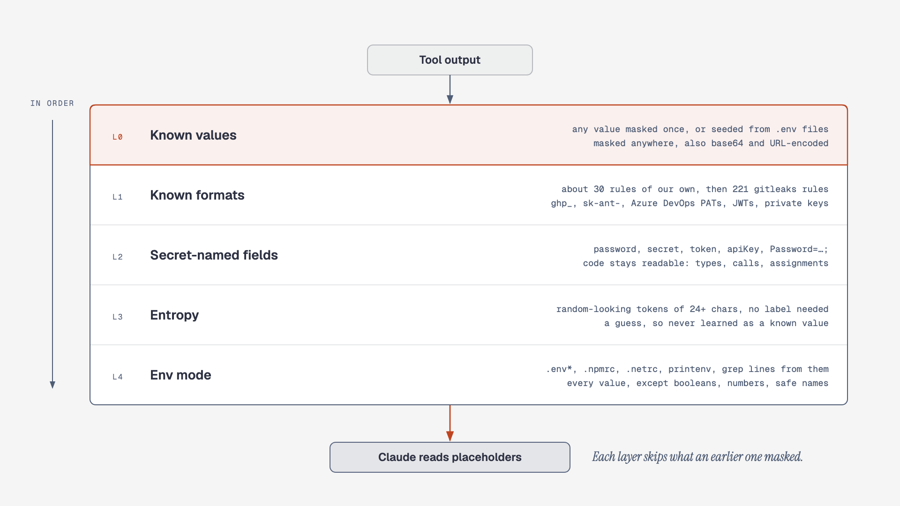

# secret-filter

A Claude Code mod that masks API keys, tokens, passwords and `.env` values in tool
output **before Claude reads it**. Masked values become placeholders,
`[REDACTED:<id>]` with an 8-hex-digit id. When Claude copies a placeholder into an
edit, the mod writes the real value back to the file, so editing config files keeps
working.

## Install

At the prompt of a Claude Code terminal session:

```
/plugin install secret-filter --marketplace emretfn/claude-secret-filter
```

From a shell:

```
claude plugin install secret-filter --marketplace emretfn/claude-secret-filter
```

In the desktop app (where `/plugin` does not run): click **+** next to the prompt
box, then **Plugins**, **Add marketplace** with `emretfn/claude-secret-filter`, then
**Add plugin**.

Nothing else needs to be installed: gitleaks' rules ship converted, as a file.

> **Requirements.** The mod uses Claude Code's *function hooks* API, which is in
> early access and may change between releases. It was built and tested on Claude
> Code 2.1.332. Classic `PostToolUse` hooks cannot do some of what it does (see below).

## How it works


- **Reading.** Every call to `Bash`, `Read`, `WebFetch`, `WebSearch` or an MCP tool runs as usual. Its output goes through the redaction engine before Claude sees it, failed calls included. Claude reads placeholders where the secrets were.
- **Everything else.** Every other row the conversation keeps (other tools such as `Monitor`, background task and subagent results, notifications, attachments) goes through the same engine before the model or the transcript file reads it. Only your own prompt and Claude's own reply are left as written.
- **The vault.** Each masked value is kept in the mod's memory under its placeholder id, with the files it was read from. Values from the project's git-ignored `.env`-style files are learned at session start.
- **Writing.** When Claude edits a file and copies a placeholder into `Edit`, `Write` or `NotebookEdit`, the write hook swaps the real value back in before the write, **only in a file the value was read from**. What the tool returns is masked again.

The diagram sources are in [`docs/`](docs/) (HTML with inline SVG).

## What it masks




Every string in the output of `Bash`, `Read`, `WebFetch`, `WebSearch` and all MCP
tools goes through these layers, in order:

| Layer | What | Example |
|---|---|---|
| Known values | Any value masked once, or found in the project's secret files at session start, is masked wherever it shows up again, also base64 and URL-encoded | a DB password in a stack trace |
| Known formats | About 30 rules of our own, plus all 221 rules of [gitleaks](https://github.com/gitleaks/gitleaks) (keyword pre-filter, entropy, allowlists) | `ghp_…`, `sk-ant-…`, Azure DevOps PATs, JWTs, private keys |
| Secret-named fields | Values of fields whose name ends in `password`, `secret`, `token`, `apiKey`, … Code is told apart from data: `token: CancellationToken` and `x = compute()` stay | `"clientSecret": "…"`, `Password=…;`, `user:pass@host` |
| Entropy | Long, random-looking tokens of no known format and with no label | an unlabeled 40-char token |
| Env mode | For `.env*`, `.npmrc`, `.netrc`, `.pgpass`, `credentials`, `secrets.json`, … and for `env`/`printenv`, every value except booleans, numbers and a few safe names (`PATH`, `NODE_ENV`, `PORT`, …) | `DATABASE_HOST=` followed by a placeholder |

Failed commands (non-zero exit) are masked too, and so are `grep` lines that come
from env files.

## Placeholders and edits

- The same value always gets the same placeholder within a session, and real values
  are kept in the mod's memory only: never written to disk, never sent to the model.
  Ids are a keyed hash with a random per-session key, so a placeholder that ends up
  somewhere public cannot be checked against guessed passwords.
- For `Edit`, `Write` and `NotebookEdit`, placeholders in the input are turned back
  into the real values just before the write. The tool's result is masked again,
  and a restored value stays masked in every later output, whatever it looks like.
- **A value is only restored into a file it was read with `Read` from**, and never
  under `.git/`. A placeholder copied into another file, a new script or a URL is
  refused, so a prompt injection cannot make the mod write a secret somewhere it
  can be run or sent. Command output (`cat a b`) names no file for sure, so its
  placeholders are restored nowhere. To move a secret to a new place, add it yourself.
- In auto mode, a write that restores real values is put to you instead of to the
  classifier, which would read its input.
- A placeholder the mod does not know (after a reload) makes the write refuse
  instead of writing a placeholder into a file. Reading the file again fixes it.
- A `Bash` command that holds a placeholder is refused: `sed` or a heredoc would
  write the placeholder itself into a file, or send it somewhere.
- The same check means the literal text of a placeholder cannot be written. To
  write one (in a test or docs), build it at run time, `'[REDACTED' + ':deadbeef]'`,
  or write `<id>` in place of the hex digits.

## False positives

The mod is tuned against real codebases (.NET, TypeScript/React/Expo, Python) so
code stays readable: git SHAs, UUIDs, migration names, code identifiers, URL slugs,
package hashes (`integrity`, `contentHash`, Go `h1:`), templates (`${VAR}`,
`{{ x }}`, `${{ secrets.X }}`, `%VAR%`), placeholder values (`changeme`, `<your-key>`,
`xxxx`) and `.env.example` files are left alone. Guesses from the entropy layer are
never learned as known values, so a false positive does not spread.

## Limits

This is defense in depth, not a guarantee. It does not:

- stop a command from **sending** a secret somewhere (`curl -d "$TOKEN" …`): it only
  filters what Claude reads.
- mask what you type or paste into the prompt yourself, or the output of a `!`
  command you run: those are yours, kept as written.
- hide a restored value from what runs beneath the write: the permission dialog
  shows it to you, and your own classic `PreToolUse` hooks receive it.
- catch every short random token: the entropy layer misses about 20% of 24-char
  tokens and 1–5% of 32+ char tokens. Known formats are always caught.
- catch secrets that are split, reversed or hex-encoded.

Seeding reads up to 50 secret files, 4 directory levels deep from the session's
directory, nearest first. In a git repository it reads only files git ignores: a
secret file committed to a cloned repository is not yours, and could plant "decoys"
that hide ordinary code. Plain words, code identifiers, plain URLs and values that
read like code are not learned, and seeds have a budget of their own (500 values, 100
per file), so they cannot crowd out what is learned while working.

## Development

```
claude plugin validate .   # what the engine would load or refuse
claude plugin test .       # unit tests (tests/redact.test.ts) and engine integration tests (tests/hooks.test.ts)
```

Tests generate their secrets at run time, so no real-looking token is committed.
Before changing the mod, read [AGENTS.md](AGENTS.md): it covers the no-egress rule,
version bumps and releases, and how to add detection rules and tests.

To update the gitleaks rules:

```
python3 scripts/gen-gitleaks-rules.py --tag v8.30.1   # or a newer release tag
claude plugin test .
```

## Credits

- Detection rules: [gitleaks](https://github.com/gitleaks/gitleaks) (MIT), see
  [THIRD_PARTY_NOTICES.md](THIRD_PARTY_NOTICES.md).
- Ideas: seeding from secret files and encoded variants from
  [securikey](https://github.com/CodeAndCanvas728/securikey); ANSI stripping and value
  heuristics from [redact-hook](https://github.com/SilentAutomaton/redact-hook);
  placeholder filters from [gitleaks-redact](https://github.com/Lingnik/claude-code-plugins);
  false-positive heuristics from [detect-secrets](https://github.com/Yelp/detect-secrets).

## License

MIT, see [LICENSE](LICENSE).
